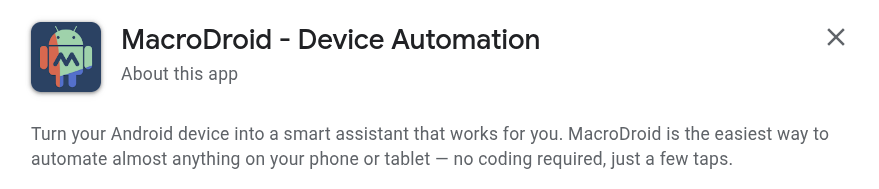
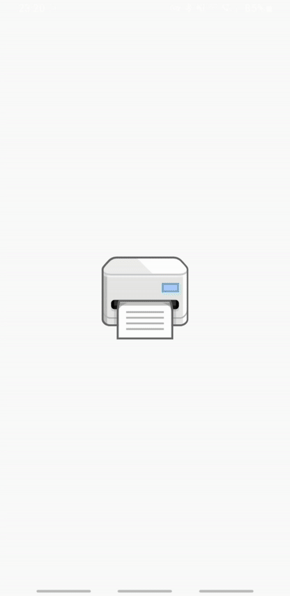
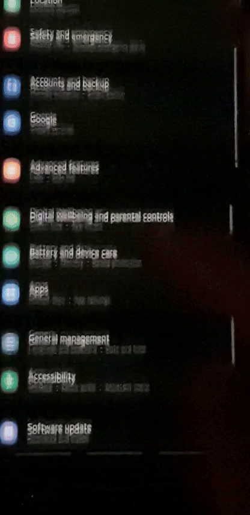
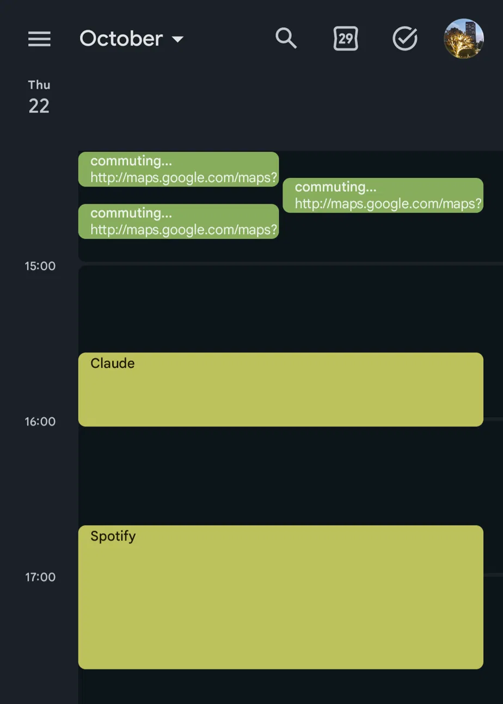
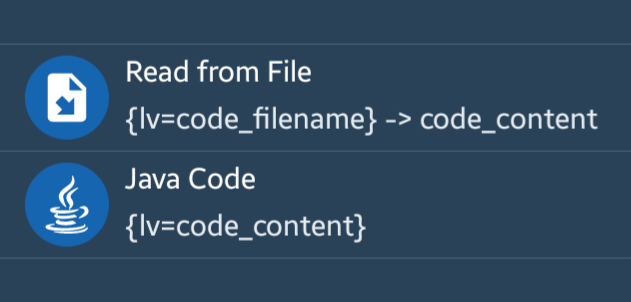
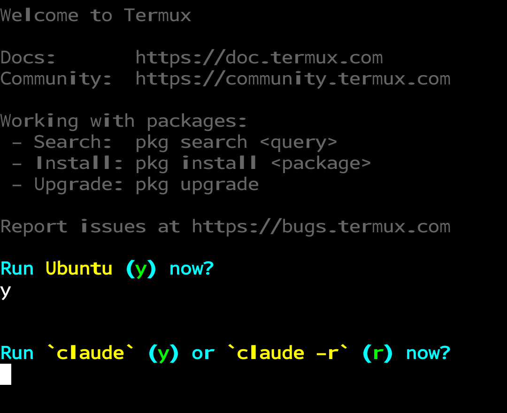

# Claude integration on Android: mobile automations with AI
<sub>This repo coveres two topics:</sub>
1. How to use [**Claude Code** on Android](#wait-claude-code-on-android) to [conveniently](#shell-profiles-profile_termux-profile_prootdistro) edit [**MacroDroid** scripts](#how-the-scripts-reach-macrodroid) in place, directly from the device, without manual importing/exporting. (See the [example scripts](#system-maintenance-restriction-srcsysmaint-restrict) you can build.)

2. How to use **Claude API** as an [autonomous agent](#ui-agent-srcui-agent) that **automatically interacts** with Android apps by tapping and navigating the screen.

<details>
<summary><h2>Some context</h2></summary>

### What is [MacroDroid](https://play.google.com/store/apps/details?id=com.arlosoft.macrodroid)?



Even though the description says "no coding required", it provides a way to run scripts written in Java (actually it's BeanShell, a scripting language, but even the app suggests that it's close enough to Java to call it *"Java Code"*).

### Why use *Java Code* in MacroDroid?

I'm aware that most of the scripts in this repo could be built with MacroDroid's nice-looking GUI action blocks. However, **not all Android APIs are available in GUI**. I also think it's worth knowing how the Android APIs are implemented programmatically.

Moreover, when working with code, you can use AI to for code edits. Although there is an official way to [integrate Claude with MacroDroid GUI](https://wiki.macrodroid.com/wiki/index.php/Build_Macros_with_Claude_or_ChatGPT), I still find it much more convenient to rather use Claude Code for editing Java files.


</details>

<details open>
<summary><h2>Scripts in this repo</h2></summary>

### UI agent (`src/ui-agent/`)

Automated UI interactions, **supervised by Claude**. You're defining a goal, and the script **reads the current screen state** and creates *rules* for it (i.e. maps screen states to actions that should be done, e.g. clicking an element), saved to `rules.json`. When no rule matches, or the UI gets stuck, **Claude is asked via API** about what should be done.

<sub>The screen recording (right below this text) shows how the UI agent works when asked to scan a document.</sub>



| Script | What it does                                                                                                                                                                                                      |
| --- |-------------------------------------------------------------------------------------------------------------------------------------------------------------------------------------------------------------------|
| [ask-claude](src/ui-agent/ask-claude.bsh.java) | Sends a prompt to the **Claude API** via an HTTP request, retries it if failed.<br/>**Requires `api_key.txt` file** in [`/data/user/0/com.arlosoft.macrodroid/files/`](https://developer.android.com/reference/android/content/Context#getFilesDir()).                                                                                                                                    |
| [get-current-screen-content](src/helpers/get-current-screen-content.bsh.java) | Reads every text visible on screen into a JSON object, with ***view IDs*** as values. Also used by [System Maintenance Restriction](#system-maintenance-restriction-srcsysmaint-restrict).                        |
| [save-a-new-rule](src/ui-agent/save-a-new-rule.bsh.java) | Checks Claude's answer and maps the **current screen state** to a rule (saved to `rules.json`)                                                                                                                    |
| [match-an-existing-rule](src/ui-agent/match-an-existing-rule.bsh.java) | Checks if there is a rule in `rules.json` for the current screen state                                                                                                                                            |
| [extract-rule-action](src/ui-agent/extract-rule-action.bsh.java) | Extracts the action of a matched rule into the `action_dict` dictionary (keys: `type`, `view_id`, `seconds`)                                                                                                      |
| [ask-user-for-instruction](src/ui-agent/ask-user-for-instruction.bsh.java) | After an error, asks the user what should happen on the current screen                                                                                                                                            |
| [plan-next-step](src/ui-agent/plan-next-step.bsh.java) | Together with all scripts above, **decides what should happen next** - whether to ask Claude for a new rule, or do the UI action based on an existing rule, etc. ([More details](src/ui-agent/plan-next-step.md)) |

#### Example workflow
<details>
<summary>
<h5>

Macro: [UI Agent](macros/UI_Agent.macro.json)

</h5>
</summary>

Loop for `timeout_mins` minutes:
> Run: `plan-next-step.bsh`
> <sub><br/>Output Variable: `planned_next_step`</sub>
>
> ```java
> if (planned_next_step == "MATCH") {
> ```
> > Run: `get-current-screen-content.bsh`
> > <sub><br/>Output Variable: `screen_contents_json`</sub>
> >
> > Run: `match-an-existing-rule.bsh`
> > <sub><br/>Output Variable: `match_result_json`</sub>
>
> ```java
> } else if (planned_next_step == "ASK") {
> ```
> 
> > Run: `ask-claude.bsh`
> > <sub><br/>Output Variable: `ask_success`</sub>
>
> ```java
> } else if (planned_next_step == "SAVE") {
> ```
>
> > Run: `get-current-screen-content.bsh`
> > <sub><br/>Output Variable: `screen_contents_json`</sub>
> 
> > Run: `save-a-new-rule.bsh`
> > <sub><br/>Output Variable: `save_result_json`</sub>
>
> ```java
> } else if (planned_next_step == "EXECUTE_MATCH" || planned_next_step == "EXECUTE_SAVED") {
> ```
>
> > ```java
> > if (planned_next_step == "EXECUTE_MATCH") {
> >   rule_result_json = "{lv=match_result_json}"
> > } else if (planned_next_step == "EXECUTE_SAVED") {
> >   rule_result_json = "{lv=save_result_json}"
> > }
> > ```
>
> > Run: `extract-rule-action.bsh`
> > <sub><br/>Output Variable: `action_dict`</sub>
>
> > Click `action_dict["view_id"]`
> > <sub><br/>Constraint: `action_dict["type"] == "CLICK"`</sub>
>
> > Press Back
> > <sub><br/>Constraint: `action_dict["type"] == "BACK"`</sub>
>
> > Wait `action_dict["seconds"]` s
> > <sub><br/>Constraint: `action_dict["type"] == "WAIT"`</sub>
>
> ```java
> } else if (planned_next_step == "DONE") {
> ```
>
> > Break from loop
>
> ```java
> } else if (planned_next_step == "ERROR") {
> ```
>
> > Run: `ask-user-for-instruction.bsh`
> > <sub><br/>Output Variable: `user_instruction`</sub>
>
> > Break from loop
> > <sub><br/>Constraint: `user_instruction == ""`</sub>
>
> ```java
> }
> ```

</details>

### System Maintenance Restriction (`src/sysmaint-restrict/`)

Useful for **self-discipline macros**, for example: when you want MacroDroid to **block another app**, in order for it to really work, you should neither be able to open the MacroDroid app, uninstall it nor revoke its permissions.

<sub>The screen recording (right below this text) shows how, as soon as the text *"MacroDroid"* is detected on screen in the Settings app, the phone gets locked.</sub>



| Script | What it does |
| --- | --- |
| [invoke-lock](src/sysmaint-restrict/invoke-lock.bsh.java) | When the `SYSMAINT_RESTRICT_SINCE` timestamp is not before 10 minutes ago, the script uses ***AccessibilityService*** to launch the home screen and ***DevicePolicyManager*** to lock the phone (without the ability to quickly unlock with biometrics). Otherwise it sets `SYSMAINT_RESTRICT_ENABLED` to false. |
| [search-in-screen-content](src/helpers/search-in-screen-content.bsh.java) | Searches the result of [get-current-screen-content](src/helpers/get-current-screen-content.bsh.java) (in local variable: `screen_contents_json`) for a given regex (local variable: `regex_to_search`). The boolean result goes to `found_on_screen`. |

#### Example workflow
Let's say we want to **block YouTube** after using it for more than 15 minutes:

<table>
<tr>
<th>Macro</th>
<th>Trigger</th>
<th>Action</th>
</tr>
<tr>
<td>

[YouTube Lock Initialize](macros/YouTube_Lock_Initialize.macro.json)

</td>
<td>

```java
APP_USAGE_MINS > 15
&& APP_PACKAGE == "com.google.android.youtube"
```

</td>
<td>

```java
SYSMAINT_RESTRICT_ENABLED = true
SYSMAINT_RESTRICT_SINCE = {system_time}
```

</td>
</tr>
<tr>
<td>

[YouTube Lock Perform](macros/YouTube_Lock_Perform.macro.json)

</td>
<td>

```java
"{fg_app_package}" == "com.google.android.youtube"
&& SYSMAINT_RESTRICT_ENABLED == true
```

</td>
<td>

Run: `invoke-lock.bsh`

</td>
</tr>
<tr>
<td>

[YouTube Lock Sentinel](macros/YouTube_Lock_Sentinel.macro.json)

</td>
<td>

```java
"{fg_activity_class}" == "com.android.settings.SubSettings"
&& SYSMAINT_RESTRICT_ENABLED == true
```

</td>
<td>

```java
regex_to_search = "MacroDroid"
```

Run: `get-current-screen-content.bsh`
<sub><br/>Output Variable: `screen_contents_json`</sub>

Run: `search-in-screen-content.bsh`
<sub><br/>Output Variable: `found_on_screen`</sub>

Run: `invoke-lock.bsh`
<sub><br/>Constraint: `found_on_screen == true`</sub>

</td>
</tr>
</table>

### Calendar log (`src/calendar-log/`)

Logs events to your calendar, very useful when you sometimes wonder: ***"What was I doing on day X?***



| Script | What it does |
| --- | --- |
| [check-location](src/calendar-log/check-location.bsh.java) | Calculates the distance between the **current location** and the previous one - if greater than **100 m**, increments `LOC_TRAVEL_MINS`. Sets the global variables: `LOC_LAST_LAT`, `LOC_LAST_LON`, `LOC_MAP_URL`. After a finished trip (or when `LOC_TRAVEL_MINS >= LOC_MAX_EVENT_MINS`) it prepares a **calendar event** (see the local variables below). The calendar is chosen by `LOC_CALENDAR_NAME`. |
| [check-current-app](src/calendar-log/check-current-app.bsh.java) | Sets the global variables: `APP_NAME`, `APP_PACKAGE`, increments `APP_USAGE_MINS` if **app didn't change** since last check. After a long series of usage of a single app it prepares a **calendar event** (see the local variables below). The calendar is chosen by `APP_CALENDAR_NAME`. |
| [insert-calendar-event](src/calendar-log/insert-calendar-event.bsh.java) | Inserts the event prepared by the two scripts above into the calendar named `event_calendar_name` (account: `CALENDAR_ACCOUNT`). Does nothing when `event_duration_mins` is `0`, and resets it to `0` after inserting. |

The `check-*` scripts hand the event over to `insert-calendar-event` through **local variables** of the macro: `event_title`, `event_description`, `event_location`, `event_calendar_name` and `event_duration_mins` (in minutes; the event ends *now* and starts that many minutes earlier).

#### Workflow

<table>
<tr>
<th>Macro</th>
<th>Trigger</th>
<th>Action</th>
</tr>
<tr>
<td>

[Calendar Log Location Change](macros/Calendar_Log_Location_Change.macro.json)

</td>
<td>

Regular interval (`LOC_CHECK_INTERVAL`)

</td>
<td>

Run: `check-location.bsh`

Run: `insert-calendar-event.bsh`

</td>
</tr>
<tr>
<td>

[Calendar Log App Usage](macros/Calendar_Log_App_Usage.macro.json)

</td>
<td>

Regular interval (`APP_CHECK_INTERVAL`)

</td>
<td>

Run: `check-current-app.bsh`

Run: `insert-calendar-event.bsh`

</td>
</tr>
</table>

</details>

<details open>
<summary><h2>Configuration</h2></summary>

### How the scripts reach MacroDroid

All **[Macros](macros)** in this repo use:

 code_content), then Java Code ({lv=code_content})" width="400">

<sub>Of course, it's possible to create a separate ***Action Block*** for that, but then you won't be able to use MacroDroid's **local variables** in the scripts.</sub>

It's not that simple though... When `code_content` contains `\n` characters, BeanShell throws *Token Parsing Error*. That's why you need to use **[build.py](build.py)**, which converts each `src/category/scriptname.bsh.java` file from this:

```java
// A very long script
System.out.println("xd");
...
```

to the code below, at path `out/scriptname.bsh`:

```java
/* A very long script */  System.out.println("xd");  ...
```

`out/` has no subfolders, so every script name must be unique across the whole `src/` (`build.py` stops with an error otherwise).

Optionally `build.py --debug`, in order to add these two lines at the beginning of the code (before merging all lines into one):

```java
System.out.println("===== scriptname.bsh =====");
System.out.println(magicText.evaluateString("{" + "trigger_that_fired_detailed" + "}\n"));
```

makes debugging much easier.

### Evaluating variables (`magicText`)

A script usually reads a MacroDroid variable with:
```java
magicText.evaluateBoolean("{v=SOME_VAR}");
```

However, MacroDroid replaces every literal `{...}` with the actual value - **once, as soon as the script is loaded**, before it runs. 

When a variable changes value during runtime, you won't see it in the console output. To keep the evaluations live, split the string:

```java
magicText.evaluateBoolean("{" + "v=SOME_VAR" + "}");
```
</details>

<details open>
<summary><h2>Editing scripts</h2></summary>

### Wait, Claude Code on Android?

There is a terminal app: [Termux](https://play.google.com/store/apps/details?id=com.termux), that works as a Linux emulator. Claude Code has **no official Android build**, but there is a [community installer for Termux](https://github.com/ferrumclaudepilgrim/claude-code-android). (Using Claude that way may be a bit laggy, but works well with `/remote-control`.)


### Shell profiles ([profile_termux](bash_profiles/profile_termux), [profile_prootdistro](bash_profiles/profile_prootdistro))

When these profiles are combined together, this happens when you open Termux:



<sub>On **Termux** startup, the console asks you to launch **Ubuntu**.
<br/>Then, on **Ubuntu** startup, it asks you to launch **Claude Code**.
</sub>

Very convenient if you use it mostly for editing MacroDroid scripts with Claude Code.

To apply [profile_termux](bash_profiles/profile_termux), run this in the default Termux session (assuming you have this repo cloned in your Android's ***Internal Storage***):

```bash
termux-setup-storage # if you haven't done that before

./bash_profiles/apply_profile.sh \
	"$PREFIX/etc/bash.bashrc" \
	"$HOME/storage/shared/claude-code-macrodroid/bash_profiles/profile_termux"
```

To apply [profile_prootdistro](bash_profiles/profile_prootdistro), run this in the environment where your Claude Code lives ([**proot-distro** Ubuntu](https://github.com/ferrumclaudepilgrim/claude-code-android/blob/main/docs/install.md#path-b-proot-distro-ubuntu) in my case):

```bash
./bash_profiles/apply_profile.sh \
	"$HOME/.profile" \
	"$HOME/claude-code-macrodroid/bash_profiles/profile_prootdistro"
```

</details>

### Make sure your Claude behaves

When coding with Claude, it's good practice to **define some rules**, e.g. in a `CLAUDE.md` file.

Examples are described below.

<details open>
<summary><h4>Logging variable values</h4></summary>

 > *Always log a value only **after it was really read or computed**, never a value that is **assumed or expected**.*

This makes debugging much easier:

```java
System.out.println("variable = `" + variable + "`");
```

Also, LLMs may have a tendency to 'guess' variable values like this:

```java
System.out.println("variable = `true`");
```

because it seems that it should be true, but it's better to **forbid that** - I myself experienced a situation when this assumption about a variable value, that AI made, was wrong.

</details>

<details open>
<summary><h4>Importing Java packages</h4></summary>

> ***Never write fully-qualified class names** inline (`java.util.List`); instead, add an `import` at the top of the file and **use the short name**.*

Annoyingly, LLMs may have a tendency to write lines of code like these:

```java
android.app.admin.DevicePolicyManager dpm = (android.app.admin.DevicePolicyManager) appContext.getSystemService(android.content.Context.DEVICE_POLICY_SERVICE);

android.view.accessibility.AccessibilityWindowInfo window = (android.view.accessibility.AccessibilityWindowInfo) windows.get(windowIndex);

accessibility.performGlobalAction(android.accessibilityservice.AccessibilityService.GLOBAL_ACTION_HOME);
```

so it may better to **forbid such lines** and require writing importing packages, so that the code is much shorter:

```java
DevicePolicyManager dpm = (DevicePolicyManager) appContext.getSystemService(Context.DEVICE_POLICY_SERVICE);

AccessibilityWindowInfo window = (AccessibilityWindowInfo) windows.get(windowIndex);

accessibility.performGlobalAction(AccessibilityService.GLOBAL_ACTION_HOME);
```

</details>

<details open>
<summary><h4>Analysing MacroDroid exports</h4></summary>

> *For `.macro`, `.ablock` and `.mdr` files: use `mdr.py` **instead of writing throwaway scripts.***

**MacroDroid exports** come with extensions: `.macro`, `.ablock` and `.mdr` - but it's all actually **JSON**, and their structure is always the same. Claude, when asked to analyze a macro, notices these patterns and keeps writing small Python scripts (`python -c "..."`) from scratch, in every new session. That's a **waste of tokens** (and your time, if you review everything Claude does, just as I do).

Instead, you can ask Claude once to write a **reusable** `mdr.py` script. My version isn't in this repo, since it was *"vibe coded"* and you can generate your own just as easily. This is how mine works:

```yml
usage: mdr.py [-h] [--limit LIMIT]
              {list,diff,keys,macros,macro,find,variables} ...

Inspect and compare MacroDroid exports (plain JSON) in `exports/`.

positional arguments:
  {list,diff,keys,macros,macro,find,variables}

    list                list exports with their indexes
    diff                what changed between two exports
    keys                top-level keys of an export
    macros              all macros and action blocks
    macro               dump one macro: triggers, constraints, variables, actions
    find                every value containing the text, with its JSON path
    variables           global variables and their values

options:
  -h, --help            show this help message and exit
  --limit LIMIT         max printed characters per value (default 300)
```

</details>
