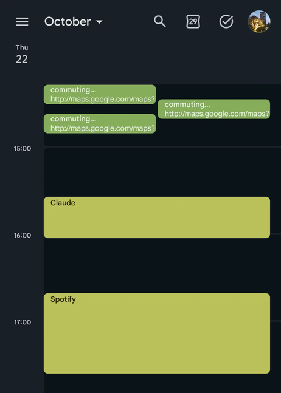

# MacroDroid and Claude: Android automation with AI

<details>
<summary><h2>Some context</h2></summary>

### What is [MacroDroid](https://play.google.com/store/apps/details?id=com.arlosoft.macrodroid)?


Even though the description says "no coding required", it provides a way to run scripts written in Java (actually that's a scripting language BeanShell, but even the app suggests that it's close enough to Java to call it Java).

### Why use Java Code in MacroDroid?

I'm aware that most of the scripts in this repo could be built with MacroDroid's nice-looking GUI action blocks. However, **not all Android APIs are available in GUI**. I also think it's worth knowing how the Android APIs are implemented programmatically.

Moreover, when working with code, you can use AI to for code edits. Although there is an official way to [integrate Claude with MacroDroid GUI](https://wiki.macrodroid.com/wiki/index.php/Build_Macros_with_Claude_or_ChatGPT), I still find it much more convenient to rather use Claude Code for editing Java files.

### Wait, Claude Code on Android?

There is a terminal app: [Termux](https://github.com/termux/termux-app), that works as a Linux emulator. Claude Code has **no official Android build**, but there is a [community installer for Termux](https://github.com/ferrumclaudepilgrim/claude-code-android). (Using Claude that way may be a bit laggy, but works well with `/remote-control`.)

</details>

<details open>
<summary><h2>Scripts in this repo</h2></summary>

### UI agent (`src/ui-agent/`)

Automated UI interactions, supervised by Claude. You're defining a goal, and the script checks the current screen state and creates **rules** for it (i.e. maps screen states to actions that should be done, e.g. clicking an element), saved to `rules.json`. When no rule matches, or the UI gets stuck, Claude is asked via API about what should be done.

The screen recording below shows how the UI agent works when asked to scan a document:


| Script | What it does |
| --- | --- |
| [ask-claude](src/ui-agent/ask-claude.bsh.java) | Sends a prompt to the Claude API via an HTTP request, retries it if failed |
| [get-current-screen-content](src/helpers/get-current-screen-content.bsh.java) | Reads every text visible on screen into a JSON object, with ***view IDs*** as values. Also used by [System Maintenance Restriction](#system-maintenance-restriction-srcsysmaint-restrict). |
| [save-a-new-rule](src/ui-agent/save-a-new-rule.bsh.java) | Checks Claude's answer and maps the current screen state to a rule (saved to `rules.json`) |
| [match-an-existing-rule](src/ui-agent/match-an-existing-rule.bsh.java) | Checks if there is a rule in `rules.json` for the current screen state |
| [run-a-single-ui-action](src/ui-agent/run-a-single-ui-action.bsh.java) | Extracts `actionType`, `actionViewId` and `actionSeconds` from a matched rule |
| [ask-user-for-instruction](src/ui-agent/ask-user-for-instruction.bsh.java) | After an error, asks the user what should happen on the current screen |
| [run-multiple-ui-actions](src/ui-agent/run-multiple-ui-actions.bsh.java) | Together with all scripts above, decides what should happen next (whether to ask Claude for a new rule, or do the UI action based on an existing rule, etc.). |

#### Example workflow
<details>
<summary>
<h5>

Macro: [UI Agent](macros/UI_Agent.macro.json)

</h5>
</summary>

Loop for `timeout_mins` minutes:
> Run: `run-multiple-ui-actions.bsh`
> <sub><br/>Output Variable: `call`</sub>
>
> ```java
> if (call == "MATCH") {
> ```
> > Run: `get-current-screen-content.bsh`
> > <sub><br/>Output Variable: `contents_str`</sub>
> >
> > Run: `match-an-existing-rule.bsh`
> > <sub><br/>Output Variable: `match_str`</sub>
>
> ```java
> } else if (call == "ASK") {
> ```
> 
> > Run: `ask-claude.bsh`
> > <sub><br/>Output Variable: `ask_success`</sub>
>
> ```java
> } else if (call == "SAVE") {
> ```
>
> > Run: `get-current-screen-content.bsh`
> > <sub><br/>Output Variable: `contents_str`</sub>
> 
> > Run: `save-a-new-rule.bsh`
> > <sub><br/>Output Variable: `save_str`</sub>
>
> ```java
> } else if (call == "EXECUTE_MATCH" || call == "EXECUTE_SAVED") {
> ```
>
> > ```java
> > if (call == "EXECUTE_MATCH") {
> >   rules_json = "{lv=match_str}"
> > } else if (call == "EXECUTE_SAVED") {
> >   rules_json = "{lv=save_str}"
> > }
> > ```
>
> > Run: `run-a-single-ui-action.bsh`
> > <sub><br/>Output Variable: `action_dict`</sub>
>
> > Click `action_dict["view_id"]`
> > <sub><br/>Constraint: `action_dict["type"] == "CLICK"`</sub>
>
> > Press Back
> > <sub><br/>Constraint: `action_dict["type"] == "BACK"`</sub>
>
> > Wait `action_dict["seconds"]` s
> > <sub><br/>Constraint: `action_dict["type"] == "WAIT"`</sub>
>
> ```java
> } else if (call == "DONE") {
> ```
>
> > Break from loop
>
> ```java
> } else if (call == "ERROR") {
> ```
>
> > Run: `ask-user-for-instruction.bsh`
> > <sub><br/>Output Variable: `user_instruction`</sub>
>
> > Break from loop
> > <sub><br/>Constraint: `user_instruction == ""`</sub>
>
> ```java
> }
> ```

</details>

### System Maintenance Restriction (`src/sysmaint-restrict/`)

Useful for **self-discipline macros**, for example: when you want MacroDroid to block the YouTube app, in order for it to really work, you should neither be able to open the MacroDroid app, uninstall it nor revoke its permissions.

The screen recording below shows how, as soon as the text *"MacroDroid"* is detected on screen in the Settings app, the phone gets locked:


| Script | What it does |
| --- | --- |
| [invoke-lock](src/sysmaint-restrict/invoke-lock.bsh.java) | When the `SYSMAINT_RESTRICT_SINCE` timestamp is not before 10 minutes ago, the script uses ***AccessibilityService*** to launch home screen and ***DevicePolicyManager*** to lock the phone (without the ability to quickly unlock with biometrics). Otherwise it sets `SYSMAINT_RESTRICT_VALUE` to false. |
| [search-in-screen-content](src/helpers/search-in-screen-content.bsh.java) | Searches the result of [get-current-screen-content](src/helpers/get-current-screen-content.bsh.java) (in local variable `contents_str`) for the regex in local variable `regex_to_search`. The boolean result goes to `found_on_screen`. |

#### Example workflow
Let's say we want to block YouTube after using it for more than 15 minutes:

<table>
<tr>
<th>Macro</th>
<th>Trigger</th>
<th>Action</th>
</tr>
<tr>
<td>

[YouTube Lock Initialize](macros/YouTube_Lock_Initialize.macro.json)

</td>
<td>

```java
APP_TIME_COUNT > 15
&& APP_PACKAGE == "com.google.android.youtube"
```

</td>
<td>

```java
SYSMAINT_RESTRICT_VALUE = true
SYSMAINT_RESTRICT_SINCE = {system_time}
```

</td>
</tr>
<tr>
<td>

[YouTube Lock Perform](macros/YouTube_Lock_Perform.macro.json)

</td>
<td>

```java
"{fg_app_package}" == "com.google.android.youtube"
&& SYSMAINT_RESTRICT_VALUE == true
```

</td>
<td>

Run: `invoke-lock.bsh`

</td>
</tr>
<tr>
<td>

[YouTube Lock Sentinel](macros/YouTube_Lock_Sentinel.macro.json)

</td>
<td>

```java
"{fg_activity_class}" == "com.android.settings.SubSettings"
&& SYSMAINT_RESTRICT_VALUE == true
```

</td>
<td>

```java
regex_to_search = "MacroDroid"
```

Run: `get-current-screen-content.bsh`
<sub><br/>Output Variable: `contents_str`</sub>

Run: `search-in-screen-content.bsh`
<sub><br/>Output Variable: `found_on_screen`</sub>

Run: `invoke-lock.bsh`
<sub><br/>Constraint: `found_on_screen == true`</sub>

</td>
</tr>
</table>

### Calendar log (`src/calendar-log/`)

Logs events to your calendar, very useful when you sometimes wonder: ***"What was I doing on day X?***
<!-- TODO: poprawić językowo powyższe zdanie -->



| Script | What it does |
| --- | --- |
| [check-location](src/calendar-log/check-location.bsh.java) | Calculates distance between the **current location** and the previous one - if greater than **100 m**, increments `LOC_TRAVEL_TIME`. Sets these global variables: `LOC_NOW_LAT`, `LOC_NOW_LON`, `LOC_MAP_URL`. Creates a **calendar event** after a finished trip (or when `LOC_TRAVEL_TIME >= LOC_MAX_EVENT_TIME`). |
| [check-current-app](src/calendar-log/check-current-app.bsh.java) | Sets the global variables: `APP_NAME`, `APP_PACKAGE`, increments `APP_TIME_COUNT` if **app didn't change** since last check. Creates a **calendar event** after long usage series of a single app. |

#### Workflow

<table>
<tr>
<th>Macro</th>
<th>Trigger</th>
<th>Action</th>
</tr>
<tr>
<td>

[Calendar Log Location Change](macros/Calendar_Log_Location_Change.macro.json)

</td>
<td>

Regular interval (`LOC_CHECK_INTERVAL`)

</td>
<td>

Run: `check-location.bsh`

</td>
</tr>
<tr>
<td>

[Calendar Log App Usage](macros/Calendar_Log_App_Usage.macro.json)

</td>
<td>

Regular interval (`APP_CHECK_INTERVAL`)

</td>
<td>

Run: `check-current-app.bsh`

</td>
</tr>
</table>

</details>

<details open>
<summary><h2>Configuration</h2></summary>

### How the scripts reach MacroDroid

All the **[Macros](macros)** use:

 code_content), then Java Code ({lv=code_content})" width="400">

Of course, it's possible to create a separate ***Action Block*** for that, but then you won't be able to use MacroDroid's **local variables** in the scripts.

It's not that simple though... When `code_content` contains `\n` characters, BeanShell throws *Token Parsing Error*. That's why I wrote **[build.py](build.py)**, which converts each `src/category/scriptname.bsh.java` file from this:

```java
// A very long script
System.out.println("xd");
...
```

to the code below, at path `out/scriptname.bsh`:

```java
/* A very long script */  System.out.println("xd");  ...
```

`out/` has no subfolders, so every script name must be unique across the whole `src/` (`build.py` stops with an error otherwise).

Optionally - with argument `--debug`, before converting, adds these two lines at the beginning (for a more clean console output, makes debugging easier):

```java
System.out.println("===== scriptname.bsh =====");
System.out.println(magicText.evaluateString("{" + "trigger_that_fired_detailed" + "}\n"));
```

### Evaluating variables (`magicText`)

A script usually reads a MacroDroid variable with:
```java
magicText.evaluateBoolean("{v=SOME_VAR}");
```

However, MacroDroid replaces every literal `{...}` with the actual value **once, when the script is loaded**, before BeanShell runs. 

When a script re-reads a variable after its value changed, you won't see it in the console output. To keep the evaluations live, split the string:

```java
magicText.evaluateBoolean("{" + "v=SOME_VAR" + "}");
```

### Shell profiles ([.bash_profile_termux](.bash_profile_termux), [.bash_profile_prootdistro](.bash_profile_prootdistro))

When these profiles are combined together, this happens when you open Termux:


Very convenient if you use it mostly for editing MacroDroid scripts with Claude Code.

#### [apply_bash_profile.sh](apply_bash_profile.sh)

This assumes you have this repo cloned in your Android's ***Internal Storage***.

To apply [.bash_profile_termux](.bash_profile_termux) to Termux:

```bash
./apply_bash_profile.sh \
	"$HOME/storage/shared/MacroDroid/.bash_profile_termux" \
	"$PREFIX/etc/bash.bashrc"
```

Then, to apply [.bash_profile_prootdistro](.bash_profile_prootdistro) to the environment where your Claude Code lives ([**proot-distro** Ubuntu](https://github.com/ferrumclaudepilgrim/claude-code-android/blob/main/docs/install.md#path-b-proot-distro-ubuntu) in my case):

```bash
./apply_bash_profile.sh \
	"$HOME/.profile"\
	"$HOME/claude-code-macrodroid/.bash_profile_ubuntu"
```

</details>

<details open>
<summary><h2>Maintenance</h2></summary>

When coding with Claude, it's a good practice to define some rules, e.g. into a `CLAUDE.md` file. Examples are described below.

#### Logging variable values
 > ***Always log a value only after it was really read or computed, never a value that is assumed or expected.***

This makes debugging much easier:

```java
System.out.println("variable = `" + variable + "`");
```

Also, LLMs may have a tendency to 'guess' variable values like this:

```java
System.out.println("variable = `true`");
```

because it should be true, but it's better to **forbid that** - I myself experienced a situation when this assumption about a variable value, that AI made, was wrong.

#### Importing Java packages
> ***Never write fully-qualified class names inline (`java.util.List`); instead, add an `import` at the top of the file and use the short name.***

Annoyingly, LLMs may have tendency to write lines of code like these:

```java
android.app.admin.DevicePolicyManager dpm = (android.app.admin.DevicePolicyManager) appContext.getSystemService(android.content.Context.DEVICE_POLICY_SERVICE);

android.view.accessibility.AccessibilityWindowInfo window = (android.view.accessibility.AccessibilityWindowInfo) windows.get(windowIndex);

accessibility.performGlobalAction(android.accessibilityservice.AccessibilityService.GLOBAL_ACTION_HOME);
```

so it may better to **forbid such lines** and require writing importing packages.

#### Analysing MacroDroid exports
> ***For `.macro`, `.ablock` and `.mdr` files: use `mdr.py` instead of writing throwaway scripts.***

These extensions are just MacroDroid's different names for **JSON**. Their format is repeatable - an LLM will notice that and, when asked about such file, will try to simplify it with Python scripts.

In each new session, it will be figuring out these scripts again and again... That's a waste of tokens - instead, you can ask it to write a `mdr.py` file. I haven't added it to this repo, since it was "vibe coded" and you can really vibe code it yourself. But this is how it works:

```math
\begin{array}{l}
\textcolor{#2ea043}{\texttt{ubuntu@localhost}}\texttt{:}\textcolor{#4078f2}{{\sim}\texttt{/claude-code-macrodroid}}\mathtt{\$}\texttt{\ python3\ mdr.py\ --help} \\
\\
\textcolor{#4078f2}{\texttt{usage:}}\texttt{\ }\textcolor{#c038c0}{\texttt{mdr.py}}\texttt{\ [-h]\ [}\textcolor{#0aa5b8}{\texttt{--limit}}\texttt{\ }\textcolor{#d4a017}{\texttt{LIMIT}}\texttt{]} \\
\texttt{\ \ \ \ \ \ \ \ \ \ \ \ \ \ }\textcolor{#2ea043}{\texttt{\{list,diff,keys,macros,macro,find,variables\}}}\texttt{\ }\textcolor{#2ea043}{\texttt{...}} \\
\texttt{\ } \\
\texttt{Inspect\ and\ compare\ MacroDroid\ exports\ (plain\ JSON)\ in\ `exports/`.} \\
\texttt{\ } \\
\textcolor{#4078f2}{\texttt{positional\ arguments:}} \\
\texttt{\ \ }\textcolor{#2ea043}{\texttt{\{list,diff,keys,macros,macro,find,variables\}}} \\
\texttt{\ \ \ \ }\textcolor{#2ea043}{\texttt{list}}\texttt{\ \ \ \ \ \ \ \ \ \ \ \ \ \ \ \ list\ exports\ with\ their\ indexes} \\
\texttt{\ \ \ \ }\textcolor{#2ea043}{\texttt{diff}}\texttt{\ \ \ \ \ \ \ \ \ \ \ \ \ \ \ \ what\ changed\ between\ two\ exports} \\
\texttt{\ \ \ \ }\textcolor{#2ea043}{\texttt{keys}}\texttt{\ \ \ \ \ \ \ \ \ \ \ \ \ \ \ \ top-level\ keys\ of\ a\ export} \\
\texttt{\ \ \ \ }\textcolor{#2ea043}{\texttt{macros}}\texttt{\ \ \ \ \ \ \ \ \ \ \ \ \ \ all\ macros\ and\ action\ blocks} \\
\texttt{\ \ \ \ }\textcolor{#2ea043}{\texttt{macro}}\texttt{\ \ \ \ \ \ \ \ \ \ \ \ \ \ \ dump\ one\ macro:\ triggers,\ constraints,\ variables,\ actions} \\
\texttt{\ \ \ \ }\textcolor{#2ea043}{\texttt{find}}\texttt{\ \ \ \ \ \ \ \ \ \ \ \ \ \ \ \ every\ value\ containing\ the\ text,\ with\ its\ JSON\ path} \\
\texttt{\ \ \ \ }\textcolor{#2ea043}{\texttt{variables}}\texttt{\ \ \ \ \ \ \ \ \ \ \ global\ variables\ and\ their\ values} \\
\texttt{\ } \\
\textcolor{#4078f2}{\texttt{options:}} \\
\texttt{\ \ }\textcolor{#0aa5b8}{\texttt{-h,\ --help}}\texttt{\ \ \ \ \ \ \ \ \ \ \ \ show\ this\ help\ message\ and\ exit} \\
\texttt{\ \ }\textcolor{#0aa5b8}{\texttt{--limit}}\texttt{\ }\textcolor{#d4a017}{\texttt{LIMIT}}\texttt{\ \ \ \ \ \ \ \ \ max\ printed\ characters\ per\ value\ (default\ 300)} \\
\end{array}
```

</details>
